# Smart House Annotation App — Architecture Plan

**Version:** 2.0 · **Date:** 12 Nov 2026 · **Based on:** PRD v1.0, `Locations.txt`, 4 JSON config files, and the new requirement: **sensor data captured from a smartwatch over BLE (Bluetooth Low Energy) via each participant's phone**

> [!IMPORTANT]
> **What changed from v1.0.** The app is no longer only an annotation tool. It now collects **sensor data plus ground-truth labels** for activity recognition. Four consequences follow:
> 1. The phone needs a **native companion app (Flutter)**. A web app can't do BLE on iOS: Safari has no Web Bluetooth, and a web app can't hold a BLE connection in the background.
> 2. **Time synchronisation is now the most important quality attribute.** Labels are only useful if they line up with sensor samples to within a fraction of a second.
> 3. Data volume grows from about 100 rows a day to **about 20 million samples a day**, so storage moves to **PostgreSQL + TimescaleDB**, with Parquet export.
> 4. PRD Open Question 5 (a moment in time vs a start/end time) now matters a lot. See §14.

---

## 1. Executive Summary

| Driver | Consequence |
|---|---|
| Continuous BLE streaming from a wrist device, in the background, all day | Native Flutter app with a **foreground BLE service**; the watch's **offline recording** as a backup |
| Labels must line up with sensor samples (< 100 ms target) | **Three-clock sync chain** (watch → phone → server) with drift correction |
| Zero data loss, intermittent Wi-Fi | Phone-side **SQLite buffer**; **chunked, idempotent** uploads |
| High data volume | **TimescaleDB** hypertables (compressed); **Parquet** export for machine learning |
| Config-driven annotation UI (unchanged) | Same config pipeline as v1: validate → normalise → hash → freeze per session |

**Recommended stack:**
- **Phone:** Flutter app for annotation + BLE sensor capture
- **Watch:** Polar device with the official Polar BLE SDK, behind a device adapter layer
- **Server:** Node.js/Fastify API with PostgreSQL 16 + TimescaleDB
- **Researcher console:** React web app
- **Deployment:** Docker Compose

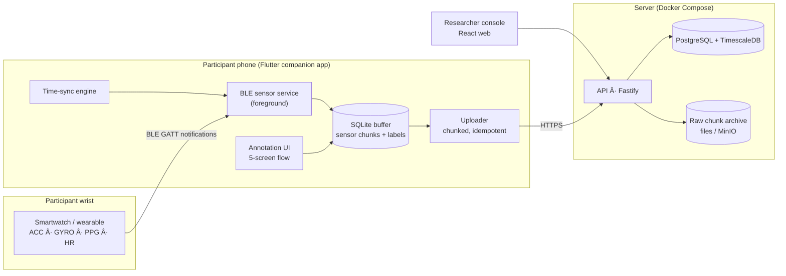

---

## 2. Analysis of the Folder

### 2.1 Inventory

| File | Role | Status |
|---|---|---|
| PRD `.docx` / `.pdf` | Requirements v1.0 (annotation only) | ⚠️ **Out of date:** says *"No sensor integration"* (non-goal). Needs a PRD v1.1 |
| `Locations.txt` | Original brief | Wording differs from the JSON files |
| `scenario.json` | Roles | ❌ Invalid JSON (trailing comma) |
| `locations.json` | 11 locations | ⚠️ Names don't match the mapping file |
| `activities.json` | 19 activities | ⚠️ id 17 has a different name in the mapping file |
| `activities_location.json` | Activity → zone (by name) | ⚠️ Matches by name; one location per activity only |

### 2.2 Config Integrity Check

| # | Issue | Evidence | Severity |
|---|---|---|---|
| C1 | Trailing comma | `scenario.json` | **Blocker** |
| C2 | Zone ↔ location name mismatch | `landing`/`landing area`, `bedroom_1`/`bedroom 1`, `bedroom_2`/`bedroom 2` | **Blocker:** Landing and both bedrooms would show no activities |
| C3 | Activity name drift | id 17: two different labels | Medium. This is now a *class label* in the ML dataset, so it must be exact |
| C4 | One location per activity | Brief says Entering/Exiting happen at both doors | Medium |
| C5 | 1-based vs 0-based ids | `Locations.txt` vs JSON | Low |
| C6 | Names defined twice | Two files define activity names | Low |
| C7 | Sketch vs config | "Vacuum" appeared in the sketch only | ✅ **Resolved:** added as activity **19 "vacuuming living"** (zone: living) to `activities.json` and `activities_location.json` |
| C8 | Sketch vs config | Sketch 1 has one "Bedroom" (10 tiles); config has Bedroom 1 + 2 (11) | Decide: one or two bedrooms? |
| C9 | Sketch vs config | Sketch 4 shows 4 persons (A–D); `scenario.json` has 3 | Illustrative, or a 4th resident? |
| C10 | Missing labels | Sketches use short labels ("F Door", "Window", "Sit on couch", "Collab") that are not in the config | Add an optional `short_label` field |
| C11 | Missing screen | No sketch for the Review/Submit screen | Designed in §4.3; needs confirmation |

### 2.3 New Gap: Sensor Configuration

There is **no config for the sensors**: which streams, at what rate, or which watch belongs to which participant. A new file, `sensors.json`, is proposed (§5.5). It is versioned and hashed exactly like the other four.

---

## 3. Architectural Decisions (ADRs)

| ADR | Decision | Rationale | Rejected |
|---|---|---|---|
| 01 | **Flutter companion app** (iOS + Android) holds both the annotation UI and BLE capture | BLE needs native APIs and background modes. One codebase for both platforms. The Polar SDK has a maintained Flutter plugin (`polar`) | PWA + Web Bluetooth (no iOS, no background); React Native (BLE + Polar bindings less mature); two native apps (twice the cost) |
| 02 | **Device adapter layer**, with Polar as the primary device | The user wants open/generic hardware without lock-in. Polar's official SDK gives timestamped **raw** ACC/GYRO/MAG/PPG/PPI/HR plus on-device offline recording | Building on raw GATT only (re-implementing vendor protocols); Empatica (cloud-centric, no simple raw BLE streaming); Bangle.js/PineTime as primary (open, but research-grade timestamping must be custom firmware) |
| 03 | **Three-clock sync with drift regression** | Labels and sensor data come from different clocks. Small errors across clocks mislabel short activities like doors and stairs | Trusting phone receive-time (BLE batching adds 50–500 ms of jitter) |
| 04 | **Chunked sensor upload** (about 10 s chunks, UUID, gzip) with an idempotent server | Efficient on battery and network. Retries are safe | Per-sample streaming over WebSockets (fragile, costly on battery) |
| 05 | **PostgreSQL + TimescaleDB** for samples, **Postgres tables** for sessions and labels | One database engine. Time-series compression (10× or more). SQL joins between labels and samples | InfluxDB (a second database; awkward joins with labels); flat files only (no queries or health checks) |
| 06 | **Raw chunk archive kept unchanged** (gzip files on disk or MinIO) | Data can be re-decoded and clocks re-synced later without loss | Keeping only decoded data |
| 07 | **Config snapshot frozen per session** (now including `sensors.json`) | Traceability for every label and every sample | Reading config live |
| 08 | **Explicit state machine** for the fixed 5-screen flow | Correct Edit and re-validation behaviour | Ad-hoc navigation |
| 09 | **Capability-token auth** (QR join per role) plus a researcher PIN | No accounts (PRD), but still private | Full accounts |
| 10 | **OpenAPI as the contract** (generated from the server's Zod schemas) with **Dart and TS clients generated from it** | Frontend and backend no longer share a language | Hand-written clients |

---

## 4. Logical Architecture

### 4.1 Phone App Components

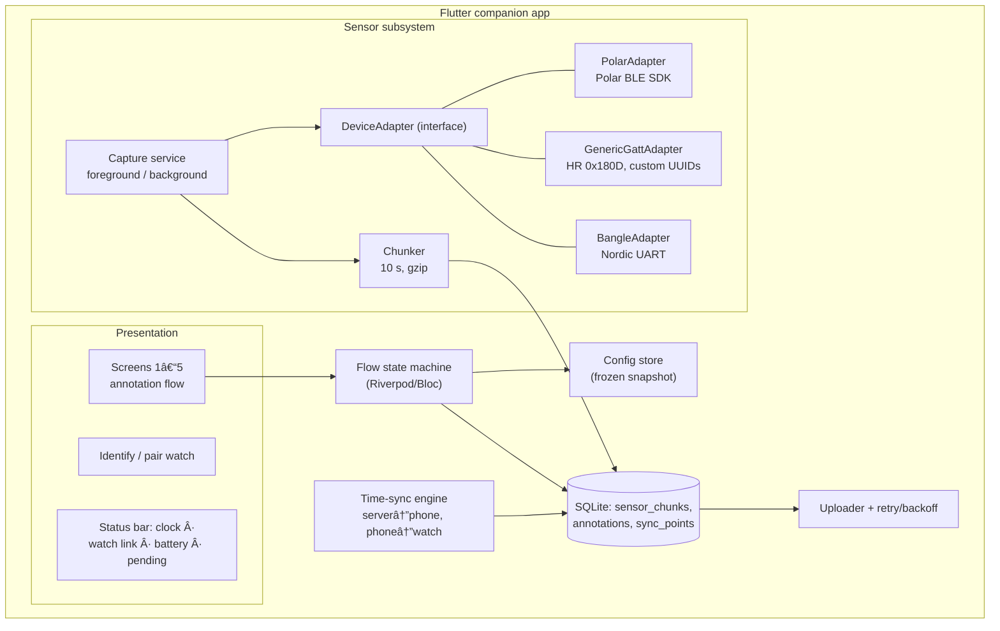

**DeviceAdapter interface** (every device implements it):

```dart
abstract class DeviceAdapter {
  Stream<DiscoveredDevice> scan();
  Future<void> connect(String deviceId);
  Future<DeviceCapabilities> capabilities();          // streams, rates, ranges
  Stream<SampleBatch> start(StreamType type, StreamSettings s);
  Future<void> setDeviceTime(DateTime utc);            // where supported
  Future<DeviceStatus> status();                       // battery, firmware, rssi
  Future<void> startOfflineRecording(...);             // optional backup
  Future<List<OfflineRecording>> fetchOfflineRecordings();
}
```

Each `SampleBatch` carries **device timestamps** per sample (or a first timestamp plus the sample rate), the phone receive time, and a sequence number, so gaps can be detected.

### 4.2 Server Components

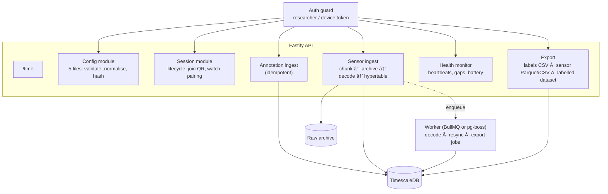

Sensor decoding and large exports run in a **background worker**, so the API stays responsive.

### 4.3 Annotation UI Specification (from the hand sketches)

````carousel
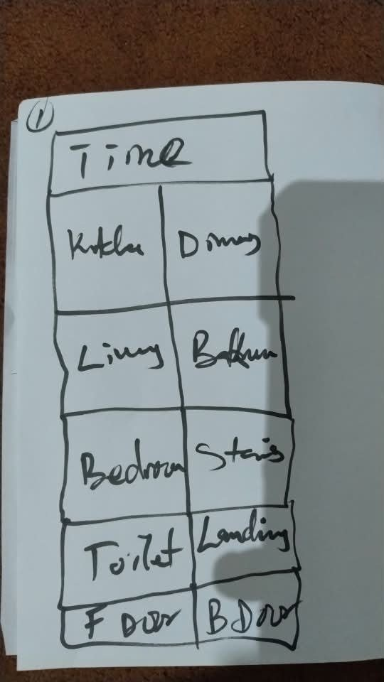
<!-- slide -->
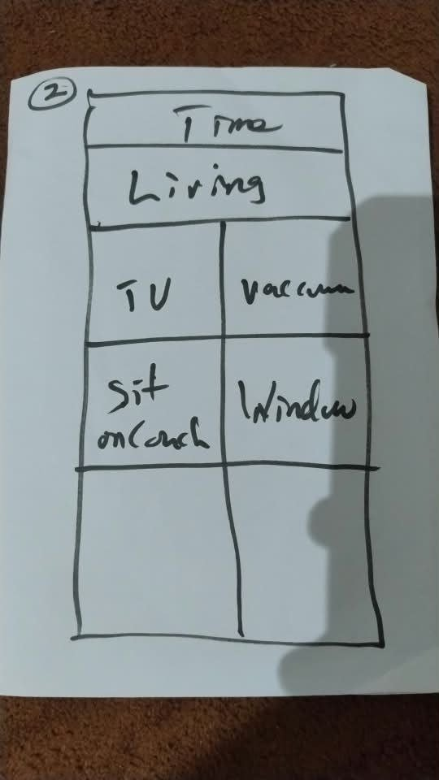
<!-- slide -->
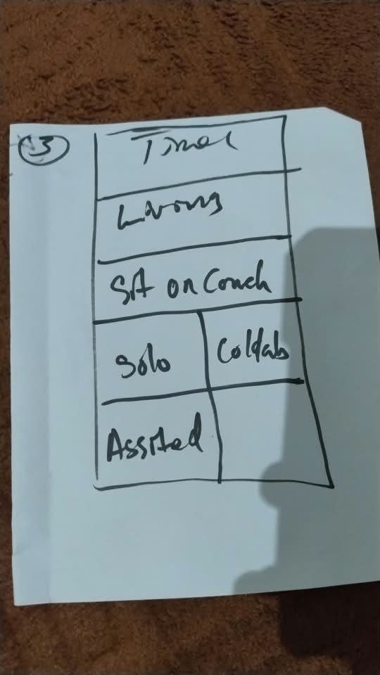
<!-- slide -->
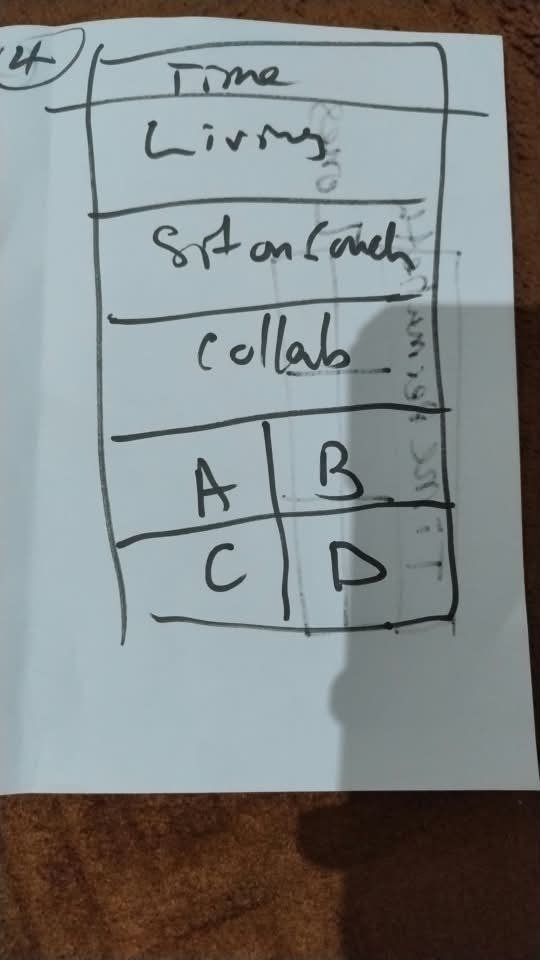
````

**One layout pattern for all screens:** each previous choice becomes a **full-width banner row** stacked under the clock, and the remaining space is a **2-column grid of large tiles**. The screen is portrait and the tiles fill the full width. The design is a single reusable `AnnotationScaffold` widget:

```
┌────────────────────────┐
│ Clock HH:MM:SS         │  ← fixed header (+ status icons: watch link · sync · pending)
├────────────────────────┤
│ Location   (screen ≥2) │  ← tap a banner = Edit that step (replaces separate Back)
│ Activity   (screen ≥3) │
│ Interaction(screen ≥4) │
├───────────┬────────────┤
│  Option   │  Option    │  ← 2-column grid, rows = ceil(n/2),
│  Option   │  Option    │    tile height = max(72 dp, remaining / rows)
└───────────┴────────────┘
```

| Screen | Sketch shows | Config gives | Resolution in the design |
|---|---|---|---|
| 1 Location | **10** tiles: Kitchen, Dining, Living, Bathroom, **Bedroom** (one), Stairs, Toilet, Landing, F Door, B Door | **11** locations (Bedroom 1 and Bedroom 2 separate), in a different order | The grid adapts to *n*. Tile order follows a new optional `order` field in `locations.json` (the sketch order is the default). Short labels such as "F Door" come from an optional `short_label` field |
| 2 Activity (Living) | TV, **Vacuum**, Sit on couch, Window | operating TV, **vacuuming living (id 19, added)**, resting (or working) on the couch, ventilating living | Add a `short_label` per activity (e.g. `"Window"` for *ventilating living*, `"Vacuum"` for id 19) |
| 3 Interaction | Solo, Collab, **Assisted** | PRD: solo / collaborative / **assistive** | Keep `assistive` as the stored key and `"Assisted"` as the display label, via `interactions.json` |
| 4 Person | **A, B, C, D** (4 people, current user not excluded) | `scenario.json`: **3** roles | Generated from `roles` minus the current participant. With Person_A on a 4-resident config, it shows B, C, D. The sketch is read as illustrative only. Short labels come from the role suffix (`Person_B` → "B") |
| 5 Review | **No sketch** | PRD requires Edit/Submit | Same scaffold: 4 banners plus 2 large buttons, **Edit** and **Submit ✓**. If Q9 = "skip", the confirmation becomes a 3-second **Undo** toast instead |

**Tap budget:** Solo = 3 taps + submit; Collab/Assisted = 4 taps + submit. This meets the PRD's "4 taps + 1 confirmation".

**Rules derived from the sketches:**
- No scrolling on a 5.5" or larger phone for up to 12 options (6 rows). Above that, the grid scrolls and the header stays fixed.
- Empty grid cells (e.g. the odd third interaction in sketch 3) are left blank, not stretched, which keeps the positions predictable for muscle memory.
- Banners double as navigation: tapping "Living" jumps back to Screen 1 with the earlier choices kept (Edit re-validation as in §6.1 of v1).
- Text is at least 20 sp and the screen stays on while the app is in the foreground. Orientation is locked to portrait.

---

## 5. Configuration Subsystem

### 5.1 Pipeline (unchanged from v1, plus `sensors.json`)

Tolerant parse (JSON5) → Zod schema per file → name normalisation and aliases (`bedroom_1` → `bedroom 1`, `landing` → `landing area`) → cross-file integrity checks → canonical snapshot with SHA-256 hash → frozen when the session starts.

### 5.2 Canonical Model

```ts
interface ConfigSnapshot {
  schemaVersion: 2; hash: string;
  roles: string[];
  locations:  { id: number; name: string; label: string; description?: string }[];
  activities: { id: number; name: string; label: string }[];
  activityLocations: { activityId: number; locationId: number }[];   // many-to-many
  interactions: { key: string; label: string; requiresPerson: boolean }[];
  sensors: SensorConfig;                                             // NEW
}
```

### 5.3 Normalisation Rules

These are the same as v1. `activities.json` is the source of truth for activity labels, matched by **id**. **Errors** block a session start: unresolved zones, duplicate ids, a roles count mismatch. **Warnings** don't: a location with no activities, an unmapped activity.

### 5.4 Recommended v2 Mapping Format

```jsonc
[{ "activity_id": 0, "location_ids": [0, 1] }, { "activity_id": 4, "location_ids": [5] }]
```

### 5.5 New `sensors.json`

```jsonc
{
  "device_family": "polar",                 // polar | generic_gatt | bangle
  "streams": {
    "acc":  { "enabled": true,  "rate_hz": 52,  "range_g": 8 },
    "gyro": { "enabled": true,  "rate_hz": 52,  "range_dps": 2000 },
    "ppg":  { "enabled": false, "rate_hz": 55 },
    "hr":   { "enabled": true },
    "ppi":  { "enabled": false }
  },
  "chunk_seconds": 10,
  "offline_recording_backup": true,
  "time_sync_interval_s": 300
}
```

When the app connects to the watch, it checks these streams and rates against what the device actually supports (`capabilities()`). Anything unsupported is reported to the researcher **before** the session starts.

---

## 6. Time Synchronisation (critical path)

There are three clocks: the **watch clock** (device ticks), the **phone clock**, and the **server clock** (the reference).

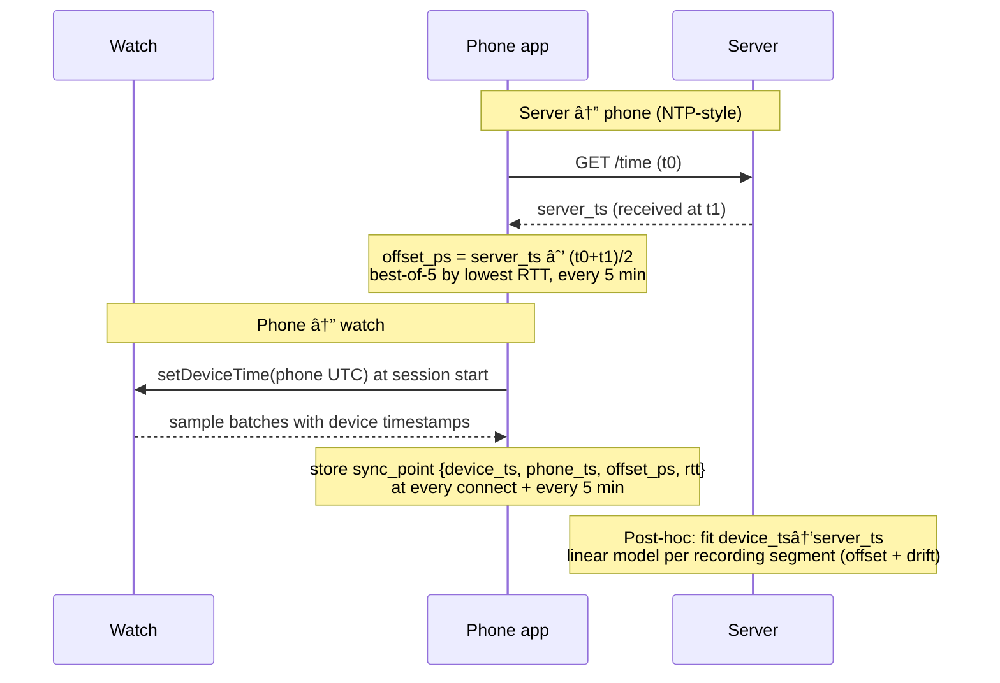

- **Stored data is never altered.** Every sample keeps its raw `device_ts`. Each chunk carries the sync points that apply to it. The server computes `ts_corrected` with a fitted line (offset plus drift), and can **re-fit later** from the raw archive (ADR-06).
- **Annotations** are timestamped with `phone_now + offset_ps`, which puts them on the same server timeline as the samples.
- **Targets:** label-to-sample alignment error under 100 ms (p95). The fit residual is stored per segment and shown in the researcher console.
- **Validation step at session start** (recommended): the participant does three sharp wrist taps while pressing "Sync" on screen. This gives a spike in the accelerometer data that can be matched to the tap timestamp, so alignment is checked against real data.

---

## 7. Data Capture and Reliability

### 7.1 Capture Lifecycle

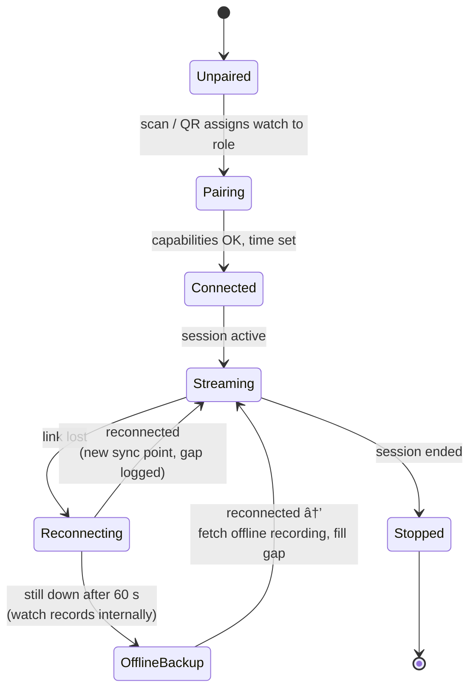

### 7.2 Reliability Measures

| Threat | Mitigation |
|---|---|
| Phone OS kills the app in the background | **Android:** foreground service of type `connectedDevice` with a persistent notification; ask to be exempt from battery optimisation. **iOS:** `bluetooth-central` background mode; keep the connection subscribed; state restoration (`CBCentralManager` restore identifier) |
| BLE link drops (out of range, body blocking the signal) | Automatic reconnect with backoff; a sequence-number gap log; the watch's **offline recording** fills the gap later |
| Phone offline / Wi-Fi down | SQLite buffer (sized for about 48 h); upload resumes automatically, oldest chunks first |
| Duplicate uploads | Chunk `chunk_uuid` and annotation `client_uuid` are unique on the server (`ON CONFLICT DO NOTHING`) |
| Phone battery | Data is only uploaded in batches (about every 10–60 s); no screen wake. Expect about 5–10 %/h extra drain, measured in the pilot |
| Watch battery | Only the configured streams are enabled. PPG is the most power-hungry and is **off by default** |
| Wrong watch on the wrong person | Watch ID ↔ role pairing is recorded per session. Both the watch name and the role are always shown in the status bar |

### 7.3 Expected Data Volume (Polar, ACC + GYRO at 52 Hz + HR)

About 105 samples per second per participant, or about 375 k samples per hour. For 3 participants × 12 h a day, that's **about 13.5 M samples a day**, or about 20 M with PPG. It comes to about 1–2 GB a day uncompressed, or **about 150–250 MB a day** after TimescaleDB compression. Upload bandwidth per phone is about 2–4 KB/s. One modest server handles this easily.

---

## 8. Backend Design

### 8.1 API Contract

| Method | Path | Auth | Purpose |
|---|---|---|---|
| GET | `/api/time` | none | Server time for sync |
| GET | `/api/admin/config/validate` | researcher | Validation report for all 5 files |
| POST | `/api/admin/sessions` | researcher | Create a session, freeze config, issue a join QR per role |
| POST | `/api/admin/sessions/:id/end` | researcher | Stop capture remotely, wait for buffers to drain, then lock |
| GET | `/api/admin/sessions/:id/health` | researcher | Per participant: watch link, battery, sample rate, gaps, pending upload, sync residual |
| GET | `/api/admin/sessions/:id/export/{labels.csv, sensors.parquet, sensors.csv, dataset.parquet}` | researcher | Exports (§9) |
| POST | `/api/join` | join token | Bind phone to session and role; returns device token and config |
| POST | `/api/devices/pair` | device | Register watch identity (vendor, model, serial, firmware) |
| POST | `/api/annotations` | device | Idempotent label ingest |
| POST | `/api/sensor-chunks` | device | gzip chunk + metadata + sync points (idempotent) |
| POST | `/api/heartbeat` | device | Link state, battery levels, buffered bytes, app version |

### 8.2 Data Model

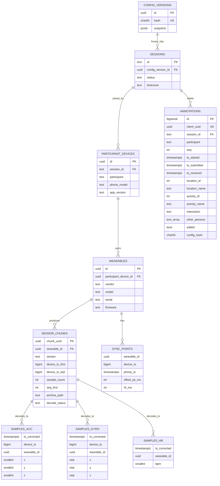

`SAMPLES_*` are TimescaleDB **hypertables**, partitioned by `ts_corrected` in 1-day chunks, with compression after 1 day and segmenting by `wearable_id`.

---

## 9. Exports

| Export | Format | Content |
|---|---|---|
| **Labels**, individual or all (PRD §8, unchanged) | CSV, UTF-8 | `session_id, participant, annotation_id, timestamp_started, timestamp_submitted, location_id, location, activity_id, activity, interaction, other_person, edited, config_version` |
| **Sensor streams** | **Parquet** (recommended); CSV optional, split per stream and participant | `participant, stream, ts_corrected, device_ts, values…` |
| **Labelled dataset** (ML-ready) | Parquet | Each sample is joined to the most recent annotation before it (or the annotation's start/end window, if §14 Q1 = start/end) |
| **Session report** | JSON/PDF | Config hash, per-participant coverage %, gaps, sync residuals, watch firmware |

> [!NOTE]
> A full-day sensor CSV is about 1 GB per participant. CSV stays available for compatibility, but Parquet (opened with pandas/polars in a single line) is the recommended format for analysis.

---

## 10. Researcher Console (React web)

- **Session setup:** validate config → create session → show a **QR code per role** → each participant scans it and pairs their watch → a **pre-flight checklist** must show all green (connected, time set, streams OK, battery > 50 %, sync tap check passed).
- **Live dashboard:** a per-participant card showing link state, battery (watch and phone), live sample rates vs configured rates, the last annotation, buffered/pending data, and the sync residual. **Alerts** when a link has been down more than 60 s or a battery is under 20 %.
- **End session:** stop capture remotely → wait for buffers to drain (progress per phone) → lock → exports become available.

---

## 11. Security and Privacy

> [!WARNING]
> Heart rate, PPG and motion data are **health-related personal data** (GDPR Art. 9). Ethics approval and informed consent must cover sensor capture. The PRD v1.0 doesn't mention this.

| Concern | Control |
|---|---|
| Access | Researcher PIN → JWT. Devices use tokens bound to `(session, role)` |
| Transport | HTTPS (TLS) for uploads. BLE pairing/bonding where the device supports it |
| At rest | Encrypted volume for the database and archive. SQLite on the phone encrypted with SQLCipher |
| Pseudonymisation | Only role labels are stored. Watch serials are kept separate from exports by default |
| Retention | Configurable per study. Researcher tool to delete a session (database + archive) |

---

## 12. Deployment and Distribution

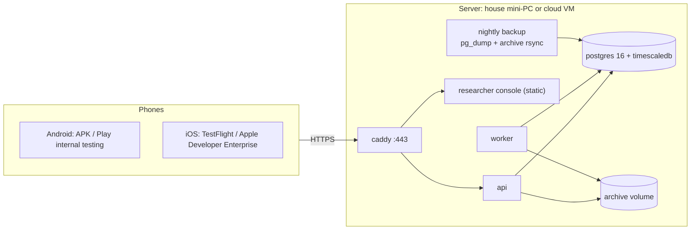

> [!TIP]
> **Use study-owned phones if at all possible.** A known model and OS version, with battery optimisation pre-configured, removes the biggest reliability risk (aggressive background killing on some Android brands). It also avoids iOS distribution hassle.

---

## 13. Quality Strategy

| Level | Focus |
|---|---|
| Unit (Dart + TS) | Config normaliser (C1–C7), flow re-validation, offset and drift regression, chunk encode/decode, CSV/Parquet writers |
| Adapter contract tests | One test suite run against every `DeviceAdapter` (Polar, generic GATT, Bangle, **a simulator**) |
| Device simulator | A fake adapter that produces sine/step signals with configurable drift, jitter and dropouts. Used in CI and in demos without hardware |
| Integration | Testcontainers with Timescale; duplicate chunk → stored once; resync recomputes `ts_corrected` |
| Soak test | 12 h continuous capture on the target phones: background survival, battery, buffer, gaps |
| Sync validation | Wrist-tap test: measured alignment error under 100 ms (p95) |
| Pilot | 1 day in the smart house with 3 participants before the study |

**Acceptance criteria to add to the PRD:** sensor coverage of at least 98 % of the session time per participant (after the offline backup fill); alignment error under 100 ms (p95); no annotation or sensor chunk lost across a 30-minute Wi-Fi outage; capture survives the phone screen being locked for 8 h.

---

## 14. Decisions Needed (updated)

| # | Question | Recommended default | Why it matters now |
|---|---|---|---|
| **Q1** | Is a label a moment in time or a start/end interval? | **Start/end** ("current activity" stays active until the next annotation, with an explicit "Stop" option) | ML needs labelled *segments*. A single moment can't say how long an activity lasted |
| **Q2** | Which device exactly? | **Polar Verity Sense or Polar 360**, after checking stream support in the Polar SDK device list. Bangle.js 2 is a fully open fallback | This decides the stream rates, offline backup and timestamp quality |
| **Q3** | Which streams and rates? | ACC + GYRO at 52 Hz plus HR; PPG optional | Battery, volume and what can be recognised |
| **Q4** | Participant phones or study-owned phones? | **Study-owned Android phones** | Background reliability, distribution |
| **Q5** | Hosting: house LAN or cloud? | House mini-PC (data stays on site; good for GDPR Art. 9) | HTTPS setup, ethics |
| **Q6** | Annotate on the phone only, or also quick labels on the watch? | Phone only in v1 | Watch firmware work (only feasible with open watches like Bangle.js) |
| Q7 | Original PRD questions 1–4 and 7 | As in v1 (one clock, QR join, solo skips Screen 4, multi-person in the data model, no shortcut) | Low |
| Q9 | Keep the Review screen (no sketch for it), or submit directly from Screen 3/4 with a 3 s Undo? | Keep Review (PRD); Undo toast as an option | Fewer taps vs fewer mistakes |
| Q10 | One "Bedroom" (sketch) or Bedroom 1 + 2 (config)? 3 or 4 residents (sketch 4)? | Follow the config: 2 bedrooms, 3 residents | Location and person grids |
| Q8 | Config fixes C1–C11 (C7 Vacuum ✅ done) | Adapter tolerates the current files; v2 format recommended | The labels are now ML class names, so they must be final before data collection |

---

## 15. Roadmap

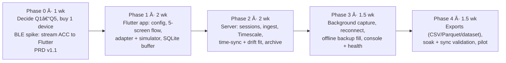

Estimate: **about 8 weeks for 2 developers** (one mobile/BLE, one backend/console). Phase 0's BLE spike is the **go/no-go gate** for the device choice.

### Repository Layout

```
smart-house-annotation/
  apps/mobile/          Flutter app (annotation + BLE capture)
    lib/features/annotate/   lib/sensor/adapters/{polar,generic_gatt,bangle,simulator}/
    lib/sync/                lib/storage/ (SQLite)    lib/upload/
  apps/api/             Fastify API + worker (decode, resync, export)
  apps/console/         React researcher console
  packages/contract/    Zod schemas → OpenAPI → generated Dart + TS clients
  config/               scenario, locations, activities, activities_location, sensors .json
  infra/                docker-compose.yml (caddy, api, worker, timescaledb), backups
  docs/adr/             ADR-01 … ADR-10
```

